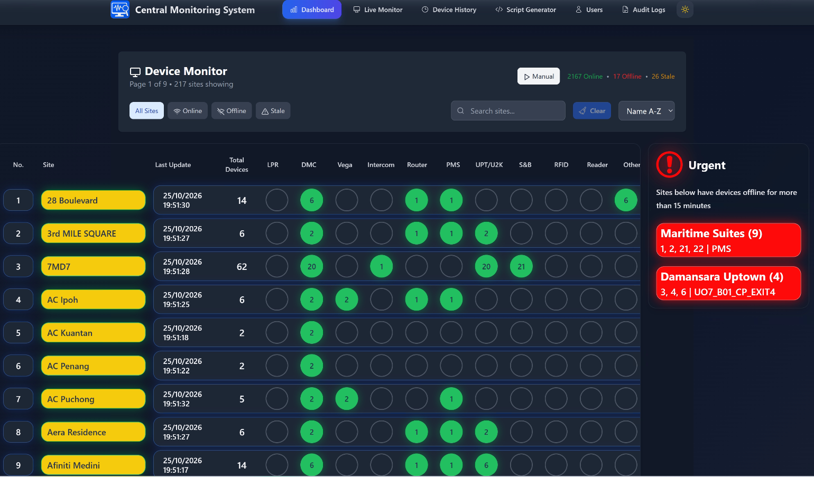
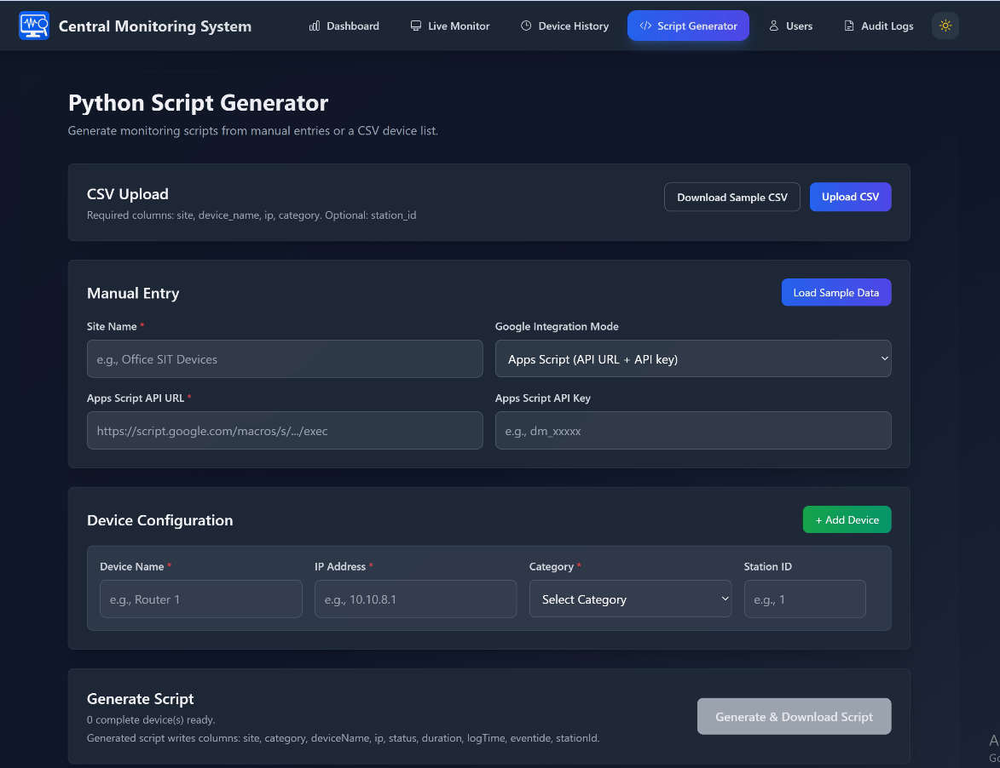

# Central Monitoring System

<p align="center">
  
</p>

## Project Overview

Central Monitoring System (CMS) is a full-stack platform for monitoring device health across multiple sites, managing users and access, and keeping historical operational records for troubleshooting and reporting.

- **Device Status Dashboard**: Visual summary of device operational status (online/offline/stale).
- **Live Monitor**: Real-time site/device view with emphasis on urgent offline conditions.
- **Device History**: Searchable historical status logs with export support.
- **Script Generator**: Generates Python monitor scripts used on remote/client sites to collect heartbeat/device status data.

## Project Objective

Provide a centralised, real-time view of device operations across sites by collecting heartbeat data, visualising status trends through charts, and maintaining device status history, enabling support teams to quickly detect, prioritise, and resolve outages or device faults.

## Tech Stack

| Category | Tools / Frameworks |
| --- | --- |
| Frontend | React 18, Vite 5, JavaScript/JSX, Tailwind CSS, Zustand |
| Backend | Java 17, Spring Boot 3, Spring Security, Spring Data JPA |
| Database | PostgreSQL |
| Messaging / Integration | RabbitMQ, Google Apps Script (sheet proxy), REST APIs |
| Scripting / Data Collection | Python 3.x (site monitor scripts), requests / ping workflows |
| Build / Runtime | npm, Maven, JDK 17 |

## Repository Structure

```text
cms/
├── cms_frontend/          # React + Vite frontend
├── cms-backend/           # Spring Boot backend
├── generated-monitors/    # Generated Python monitor scripts
├── AppScript.txt          # Google Apps Script sample/proxy logic
└── README.md
```

## Setup and Run

1. **Prerequisites**

   - Ensure the following software is installed:
      - Node.js 18+ and npm
      - Java JDK 17
      - Maven (or use `mvnw` in repo)
      - PostgreSQL
      - Python 3.x
      - Google Sheet + Apps Script (for sheet integration)

2. **Clone the repository**

   ```bash
   git clone https://github.com/w3ishendt/CMS.git
   cd CMS
   ```

3. **Configure backend credentials**
   - Copy `application-example.properties` to `application.properties` and fill in your values:

   ```properties
   # Database Configuration (PostgreSQL)
   spring.datasource.url=jdbc:postgresql://localhost:5432/postgres
   spring.datasource.username=postgres
   spring.datasource.password=your_postgre_password
   spring.datasource.driver-class-name=org.postgresql.Driver

   # Server Configuration
   server.port=${SERVER_PORT:8082}

   # Google Sheet read proxy (Apps Script web app)
   google.sheet.read.url=https://script.google.com/macros/s/your_google_sheet_url/exec
   google.sheet.read.api-key=your_google_sheet_api
   ```

4. **Configure Google Apps Script**

   - Create/Deploy your Apps Script web app and keep values aligned with backend settings.

   - Example snippet:

   ```javascript
   const API_KEY = "your_google_sheet_api";
   const SHEET_NAME = "current_sheet";
   ```

   (You can use `AppScript.txt` in this repo as a reference.)

5. **Run backend**

   ```powershell
   cd .\cms-backend
   .\mvnw.cmd spring-boot:run
   ```

   - Backend default in this project is typically `http://localhost:8082`.

6. **Install and run frontend**

   ```powershell
   cd ..\cms_frontend
   npm install
   npm run dev
   ```

   - Frontend default URL:

   ```text
   http://localhost:5173
   ```

   Optional production build:

   ```powershell
   npm run build
   npm run preview
   ```

## User Interface Layout Screenshots

### Live Monitor

<p align="center">
  
</p>

### Script Generator

<p align="center">
  
</p>

## Generating Site Monitoring Scripts

1. Open **Script Generator** in the frontend.
2. Upload CSV (or enter devices manually).
3. Generate the Python monitor script.
4. Copy the script to the remote/client site.
5. Run it:

```bash
python site_name_monitoring_script.py
```

## Notes

- Keep API keys and credentials out of source control.
- Use environment-specific configuration for local/staging/production.
- If frontend cannot load data, verify backend URL/port and auth settings first.
